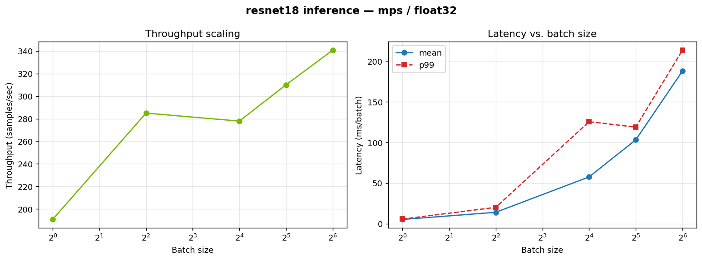

# GPU / ML Inference Performance Benchmark

A small, self-contained harness for benchmarking PyTorch model inference across
a sweep of batch sizes, measuring **throughput** (samples/sec) and **latency**
(mean / p50 / p99 ms per batch), then charting how they scale.

It runs on whatever accelerator is available and picks it automatically:
**CUDA → Apple MPS → CPU**. On CUDA it uses `torch.cuda.Event` for accurate
device-side timing; on every backend it synchronizes the device around each
timed region so the numbers reflect real compute rather than async queue-fill.

## Why

Understanding how throughput and tail latency change with batch size is the
core question in ML systems performance: small batches minimize latency, large
batches maximize hardware utilization, and the p99/mean gap exposes scheduling
jitter. This project is a minimal, reproducible way to measure that trade-off
on any GPU.

## Setup

```bash
pip install -r requirements.txt
```

## Usage

```bash
# Default: ResNet-50, batch sizes 1..64, auto-detected device
python benchmark.py

# Pick a model, dtype, and custom batch sweep
python benchmark.py --model resnet18 --dtype float16 --batch-sizes 1 8 32 128

# Force a device
python benchmark.py --device cuda --iters 50 --warmup 10

# Chart the most recent run
python plot.py
```

Results are written to `results/benchmark.csv` and `results/benchmark.png`.

### Options

| Flag | Default | Meaning |
|------|---------|---------|
| `--model` | `resnet50` | Any `torchvision.models` name |
| `--device` | `auto` | `auto` / `cuda` / `mps` / `cpu` |
| `--dtype` | `float32` | `float32` / `float16` / `bfloat16` |
| `--batch-sizes` | `1 2 4 8 16 32 64` | Batch sweep |
| `--iters` | `30` | Timed iterations per batch size |
| `--warmup` | `10` | Untimed warmup iterations (fills caches / autotunes kernels) |

## Example output

Run on an Apple M-series GPU (MPS backend), ResNet-18, float32:

```
batch=1     lat_mean=    5.24 ms   throughput=    190.7 samples/s
batch=4     lat_mean=   14.03 ms   throughput=    285.0 samples/s
batch=16    lat_mean=   57.57 ms   throughput=    277.9 samples/s
batch=32    lat_mean=  103.19 ms   throughput=    310.1 samples/s
batch=64    lat_mean=  187.79 ms   throughput=    340.8 samples/s
```



Throughput rises with batch size as the GPU stays busier, while per-batch
latency grows roughly linearly — the classic latency/throughput trade-off.

## Notes on methodology

- **Warmup** iterations are excluded from timing so one-time costs (kernel
  autotuning, memory allocation, cache fill) don't skew results.
- **Device synchronization** around each timed region is essential on GPUs:
  kernel launches are asynchronous, so without a sync you'd measure launch
  overhead, not execution.
- **p99 latency** is reported alongside the mean to surface tail behavior /
  scheduling jitter, which matters for real serving SLAs.

## Possible extensions

- Add `torch.profiler` traces to attribute time per kernel/layer.
- Compare eager vs. `torch.compile`.
- Benchmark training step time (fwd + bwd + optimizer) alongside inference.
- Sweep dtypes (fp32 vs fp16 vs bf16) to quantify mixed-precision speedups.
